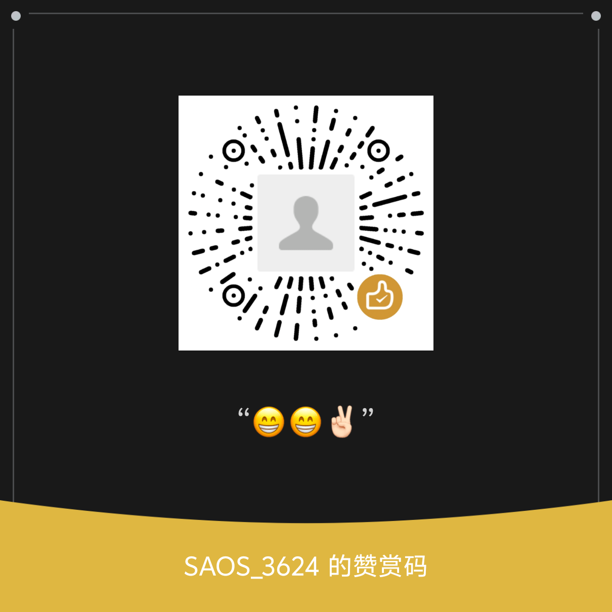

# dsh-video-storyboard

> 让 AI 真正"看过"一段视频：**一张分镜图 + 一份带时间码的文本清单**，模型据此回答"第 3 分钟发生了什么""这句话对应哪一格"。
>
> English: [README.en.md](README.en.md)
>
> 已收录于 [awesome-dsh-plugin](https://github.com/awesome-dsh-plugin)。
>
> **0.6.0 大改（2026-11-01）**：切点之后整条链路重写 —— **一帧 = 一个镜头**，格子大小 = 那个位置的
> **切点密度**（1/1 … 1/8 共八档），排布用 DP 按行打包，最后**把画布裁到内容**。
> `cells` / `sheets` / `need` / `maxPerSheet` / `adaptive` / `tileFirst` 已删除，
> 换成 `maxFrames` / `strategy` / `maxSheets` / `tierMap`。迁移与完整差异见 [CHANGELOG](CHANGELOG.md)。

> **协议变更（v0.5.0）**：本项目由 MIT 变更为 **Apache-2.0**。变更的目的是更好地保护代码版权
> （要求保留署名），同时依旧允许大家自由使用、修改，甚至商用。此前基于 MIT 发布的版本仍是 MIT，
> 已经产生的衍生版本不受影响。感谢所有使用者和开发者。
>
> **边界**：本项目不托管、不分发任何视频内容，缓存只在本地且会自动淘汰；不提供付费内容访问、
> DRM 绕过、区域限制绕过或批量抓取能力。**能不能下载某个链接取决于你有没有相应授权**，
> 请自行确认并遵守目标站点的条款与当地法律。完整说明见 [NOTICE](NOTICE)。

---

## 它解决什么问题

> **装完不能跑？先执行 `node bin/doctor.mjs`** —— 它会检查 ffmpeg / yt-dlp / ASR / 缓存目录，
> 每条都跟一句"缺什么、怎么补"。用户反馈里过半不是 bug，是没配 ASR 或装完 ffmpeg 没重启 DSH。
> 新手步骤：[docs/入门-五分钟.zh.md](docs/入门-五分钟.zh.md) · 报错对照：[docs/FAQ.zh.md](docs/FAQ.zh.md)
>
> **没配转写 = 它只能看图说话。** 能描述"画面上有个女孩在跑"，但说不出她讲了什么。
> 本机 ASR 免费、不联网，装一次十几分钟 —— 这是这个插件价值差别最大的一步，
> 别等到问"她说了什么"发现答不上来才回头配。见 [FAQ Q1](docs/FAQ.zh.md)。

多模态模型看视频有两种笨办法：

- **逐帧抽图** —— 10 分钟片子按 1 fps 抽就是 600 张图，token 直接爆。
- **只喂字幕** —— 画面里的信息（构图、动作、场景变化）全丢。

本插件走第三条：**把画面压成一张宫格图**（384 token 封顶），旁边配一份**按时间对齐的文本清单**（每格起止时间 + 这一格里的台词 + 切了几刀）。

模型得到的是"这 90 秒里发生了什么、大概在第几秒"，需要细节时再用 `video_zoom` 放大某一段。

**0.6 起，一格 = 一个镜头，格子大小不再一样**：20 秒的长镜头占满整幅，0.3 秒的快闪只有 1/8 边长。
所以一张图里同时写着"这里是个长镜头"和"这里 24 个镜头连闪"——不读文字，看格子大小就知道节奏。

## 六个工具

| 工具 | 干什么 | 何时用 |
|---|---|---|
| `video_probe` | 只读容器头：多长、分辨率、帧率、有没有音轨/字幕、已分析过没有 | **第一次接触一部片子时先调它**，不花图片 token |
| `video_storyboard` | 出宫格图 + 文本清单 | 主体功能 |
| `video_zoom` | 只看某一段：**一张图、n 帧、统一 `ceil(√n)` 档**（9 帧就是 3×3 满格） | 清单看完觉得某段重要，再放大 |
| `video_locate` | **纯文本**：一句话 → 时间码 | 知道说了什么、不知道在第几分钟 |
| `video_subtitles` | 把画面里的**硬字幕**裁成一张竖长图 + 每条的秒数 | **没有字幕轨、ASR 也转不出来**（PV / 唱歌 / 双语艺术字）—— 只能看的时候 |
| `video_help` | 印一份手册：token 怎么算、六个策略各是什么、档位/`tierMap`、`cutFloor`、清单预算 | 参数含义或价钱不确定时；用户说"6格/12格"时 |

> 为什么有 `video_help`：工具的 description 和每个参数的 description 是**每一轮请求都要重发**
> 的常驻文案，写得越长，模型每一轮都付一次钱。所以契约里只留"什么时候调、默认值是多少"，
> "为什么 / 多少 token / 实测数字"搬进 `video_help`，需要时现取（零图片 token）。

> `video_storyboard` 的 `quality`（`low`/`medium`/`high`）只影响**贴链接**时的下载清晰度，
> 本地文件永远读原片。默认 `medium`（720p）；嫌糊传 `high`，嫌慢传 `low`。
> 价位和清晰度的取舍见 [FAQ「关于钱和清晰度」](docs/FAQ.zh.md)。

## 档位：格子为什么大小不一样

图片按**像素**计费（42px 一格：`rows×(cols+1)+2`，地板 544²、封顶 994 @1300×1300），格子越小能塞的帧越多 ——
所以"这一帧占多大"本身就是信息量分配，也直接决定钱。

**帧 = 一个镜头**（真切点切段 + 积分采样点补段），**档位 = 那个位置的切点密度**：

| 档位 | 格子边长 | 800 宽画布上的实际像素 | 典型场景 |
|---|---|---|---|
| 1 | 1/1 | 800×450 | 20 秒的长镜头 |
| 2 | 1/2 | 400×225 | 3–5 秒的常规镜头 |
| 4 | 1/4 | 200×113 | 1 秒左右的快切 |
| 8 | 1/8 | 100×56 | 0.3 秒一闪而过的快闪 |

档位是算出来的（100 帧卷积窗 → 每帧切点概率 → 50 帧平滑 → 7 阈值 + 5% 滞回），
由**积分假切点**切出来的帧再 **+3 档**（那里画面一直在变，一帧代表不了多久）。
两个旋钮可以覆盖它 —— 一个是预设，一个是精确映射：

```js
video_storyboard({ input, strategy: 'saver' })                    // 预设：每帧降一档
video_storyboard({ input, tierMap: { 5: 4, 6: 4, 7: 4, 8: 4 } })   // 精确：5–8 档一律按 1/4
```

### 六个档位（第一个是默认）

| `strategy` | 每帧多大 | 90 秒 PV 实测 | 什么时候用 |
|---|---|---|---|
| **`auto`（默认）** | 张数按时长定（≈4 分钟一张），再挑最小格还认得出的最省那档 | **1~3 张** | 什么都不填时就用它 |
| `full` | 升一档（1 档不再升） | 18 张 / 6912 token | 要读画面里的字、认脸 |
| `standard` | 1 档压成 1/2 | 5 张 / 1920 | 想看清每个镜头 |
| `compact` | 降一档 | 3 张 / 1152 | 日常：看得清又便宜 |
| `skim` | 全部 1/8，无假切点，切点按 0.35 s 合并 | 1 张 / 384 | 一条 PV 一张图 |
| `brief` | 全 1/8，切点间隔**自适应加大**到整段装进一张图 | 1 张 / 384 | 5 分钟视频一张图看完 |

**`auto` 是 0.6.1 的默认值**，起因是一次真实的账：新会话看到枚举里第一个名字是 `full`，
就选了它 —— 一条 90 秒 PV 花掉 6912 token，是 `compact` 的 6 倍。模型看不见"多一张图多少钱"，
所以选档这件事收回工具自己：

- **张数只按时长算**（`autoSheetCap`，默认 240 s/张，`DSH_STORYBOARD_SECONDS_PER_IMAGE` 可调）：
  5 分钟 → 1~2 张，30 分钟 → 8 张，2.5 小时 → 39 张。同一时长的片子，钱是可预期的。
- **在预算内挑最省的那档**：张数一样时 compact 装得下更多帧。只有当最小格已经认不出东西
  （< `shot`）才往 standard / full 退；压缩到色块就翻倍张数重试（最多三轮）—— 预算让位于可读性。
- 结果里会写 `size policy: auto chose …` 和"同一批帧在别的档要几张"，下一次它就有依据覆盖。
- 不想要 auto：`DSH_STORYBOARD_AUTO=0`，或 `~/.dsh/video.json` 里 `{"storyboard": {"auto": false}}`，
  退回 `compact`（0.6.0 的默认值）。

不知道这部片有多少刀时，先用 `dryRun: true` 问一次（扫描有缓存，第二次几乎免费）：

```js
video_storyboard({ input, dryRun: true })
// → cuts="46 (avg 2.0s)" · frames=21 · compact 1 image / standard 1 / full 2 / skim ≤1
//   recommended: compact
video_storyboard({ input, strategy: 'compact' })   // 再真正出图
```

> 0.6.0 之前叫 `quality` / `balanced` / `saver` / `frugal` / `thrifty` / `ultra`（还有"乞丐/恭喜发财/丐中丐"
> 这种名字）。旧名仍然认，会自动映射到新名，不会报错。

`tierMap` 是精确覆盖，接在 `strategy` 之后：没列出的档位保持原值，多档映射到同一档等于合并尺寸，
补位帧（自由尺寸）不参与映射，越界的键值直接忽略。清单里会回显 `tierMap=1->1,2->1,…`。

## 为什么不是固定宫格

旧版（≤0.5.x）是"你要几格，我就切成 k×k"。问题不在实现，在**前提**：它假设所有镜头一样重要。

一段 90 秒的 PV 里，前 20 秒可能只有 6 个长镜头，后 20 秒有 24 个 0.25 秒的快闪。固定 16 格平均分，
结果是**长镜头浪费了 12 格的面积，快闪被压成 100×56 的色块** —— 两头都没照顾好。

现在这张图是这么排出来的：

1. **帧 = 镜头**。切点切段，一段一帧。长镜头就是一帧，快闪也是一帧，时间轴永远连续。
2. **格子大小 = 那个位置的切点密度**（8 档，边长 1/k）。快的地方小格、慢的地方大格，
   **同一张图里两种节奏同时可见** —— 不用读数字，看格子大小就知道哪里开始快剪。
3. **按行打包 + 裁到内容**。装不下才开下一张；排完把底部/右侧的空白裁掉，所以每张图高度不同，
   但内容一点不少。
4. **补位**。某张图只剩 2 帧（片尾标题 + 演职员表）时，把那几段再切几刀，凑成能铺满的格数。

实测同一段 90 秒 PV：

| 版本 | 张数 | token | 快剪区格子 | 长镜头格子 |
|---|---|---|---|---|
| 0.5.x 固定 16 格 | 2 | 768 | 100×56（糊） | 200×113（浪费） |
| **0.6.0 档位排布** | **3**（`compact`） | **1152** | 114×54 但**按密度分配** | **400×225** |

多花 384 token，换来长镜头 4 倍清晰度 + 快剪区不再裁掉镜头。这是这套算法唯一想做的事。

## 安装

**从零开始的完整步骤（含依赖、自检、排错）见 [docs/INSTALL.zh.md](docs/INSTALL.zh.md)。**

三句话版本：

```bash
winget install Gyan.FFmpeg                    # 必须：ffmpeg + ffprobe
pip install --user -U yt-dlp                  # 只有贴 B 站/YouTube 链接才需要
dsh plugin --profile web add dsh-video-storyboard       # 装插件，然后重启 DSH
```

`dsh plugin` 只管 `web` 这类普通 profile；**桌面版（Electron）的 `desktop` profile 会被拒绝**，
用源码安装：`git clone` 后 `node scripts/install-dev.mjs`（复制目录，改完要重跑）。

| 依赖 | 必须吗 | 不装会怎样 |
|---|---|---|
| ffmpeg + ffprobe | **必须** | 第一步就报错 |
| yt-dlp | 可选 | 本地文件照常能用，贴链接不行 |
| ASR 服务 | 可选 | 能出图，但清单里没有台词 |

插件**不打包** ffmpeg 和 yt-dlp，只调用你自己装的那份。找不到时会给出安装指引，不会静默失败。

## 怎么用

### 贴一个链接

```
https://example.com/some-video
```

**任何 yt-dlp 支持的站点**都行（YouTube、Vimeo、各种自建站……完整列表见 yt-dlp 文档）。
插件会自己下载、缓存，然后用本地文件的那套流程跑。竖屏、DASH、多分P 都处理了。

> ⚠️ **能不能下，取决于你**：请自行确认对目标内容有下载/使用授权，并遵守该站点的条款与
> 当地法律。本项目不提供任何绕过付费、会员、DRM 或区域限制的能力，也不代为判断授权。

### 本地文件

```bash
node bin/storyboard.mjs film.mp4 --out film.png                    # 默认：均衡，一条 90 秒 PV 5 张
node bin/storyboard.mjs film.mp4 --strategy thrifty --out cheap.png # 全 1/8，一张图 384 token
node bin/storyboard.mjs film.mp4 --strategy ultra --out one.png     # 丐中丐：间隔自适应到装进一张
node bin/storyboard.mjs film.mp4 --tier-map '{"5":4,"6":4,"7":4,"8":4}'   # 快剪全部按 1/4
node bin/storyboard.mjs film.mp4 --max-sheets 4 --out film.png      # 硬性限制张数
node bin/storyboard.mjs film.mp4 --batch 300 --out film.png         # 长片按 5 分钟切窗
node bin/asr-check.mjs film.mp4 --from 100 --seconds 12             # 只测 ASR
```

## 参数

| 参数 | 默认 | 说明 |
|---|---|---|
| `input` | — | 本地路径或 http(s) 链接 |
| `from` / `to` | 全片 | 只看这一段 |
| `maxFrames` | **0（不限）** | 最多取多少帧（一段 = 一个镜头）。0 = 不封顶：几千刀就几千帧；填正数才按"合并最短的段"收缩 |
| `strategy` | `auto` | **`auto`（默认）：先按视频时长定张数预算（≈4 分钟一张），再在 compact/standard/full 里挑"最小格还认得出、张数最少"的那档**，并把三档各自的代价写进清单。显式值：`full` 每帧升一档 / `standard` 只把 1 档压成 1/2 / `compact` 降一档 / `skim` 全 1/8 + 无假切点 + 切点按 0.35s 合并 / `brief` 切点间隔自适应加大到**整段装进一张图**（旧名 quality/balanced/saver/frugal/thrifty/ultra 仍认）|
| `dryRun` | `false` | **只扫描 + 排布，不出图、不取帧、不转写**：回报切点数、帧数、每个档位要几张图。用来在花第一张图之前决定档位 |
| `scanGap` | `0` | 两个切点之间至少隔几秒（0 = 不合并）。调大能把连闪的镜头并成一个边界 |
| `integral` | `true` | 是否在长镜头里按"画面变化积分"补帧。关掉就只留真切点 |
| `integralSeconds` | `6` | 一个采样帧代表多少累积变化（1–30）。阈值对着**固定参考强度**，不是"每 N 秒一帧"：画面动得快就补得密，慢就补得疏，完全静止的镜头一个点都不补 |
| `tierMap` | — | 档位映射表 `{5:4,6:4}`：接在 `strategy` 之后，未列出的档位保持原值；多档映射到同一档 = 合并尺寸 |
| `maxSheets` | **0（不限）** | 最多几张图。0 = 排布器说几张就几张；填正数则超了合并段重排（时间覆盖不变） |
| `budget` | 360000 | 单图像素，默认 360k = 800×450（≈233 token）。**上限 1.69M = 1300×1300（≈994 token）**：按像素线性计费，抬上去是加钱买清晰度，不是免费；低于 ~296k 也不再便宜（计费时按 544² 放大算，192 token）—— 所以给更小的 budget 会被**抬到地板**并在清单里说明 |
| `pick` | `mid` | 取帧策略：`mid` 段中点 / `sharp` 3 候选选最锐（3 倍解码）/ `thumb` 段内最典型 |
| `burn` | `index` | 烧格号；`none` 关掉 |
| `transcript` | `auto` | `auto` / `off` |
| `transcriptFile` | — | 直接喂已有的 SRT/JSON，跳过 ASR |
| `detail` | `med` | 每格台词预算：`low` 60 / `med` 120 / `high` 400 字 |
| `cellRange` | — | 分页看文本清单 |

## 输出长什么样

一张图 + 一段文本：

```
<storyboard path="film.mp4" duration="18.40" window="0.00-18.40" image="800x469"
            grid="30 frames on 1 image(s)" burn="index" cell>=93x47
            tokens="233" cuts="29 (avg 0.6s)">
plan: strategy=balanced (1 档压成 1/2 尺寸) · 30 frames on 1 image(s) ·
      tiers 1/2×5 1/4×1 1/6×2 1/7×2 1/8×20 · canvas=800x450 · fill=99.4% · maxFrames=96
cost: 1 image(s) ≈ ~233 vision tokens (233/img avg; 42px token grid, floor 544², cap 994)

cell 1 = 00:00.00-00:02.00  k=2 (1/2)
cell 7 = 00:12.00-00:12.27  cuts 1  k=6 (1/6)
    "这段台词"
```

一行一个镜头，`k=` 就是这一帧的档位（边长 1/k）。长镜头是大格、快剪是小格，
所以一张图里同时能看到"这里是一个 20 秒的长镜头"和"这里是 24 个 0.25 秒的快闪"。

几条设计原则：

- **清单只给原材料，不下结论。** 不说"这是高潮""这里是角色 A"，只给时间、刀数、台词 —— 判断是模型的事。
- **每加一行都要能说出它挡掉了什么误判。** 说不出来就不加。
- **数字不可信时要说出来。** 例如连续运镜被逐帧切碎时，清单会写 `cut count unreliable here`，而不是让模型拿 `cuts=N` 当节奏依据。

## 算法要点

1. **画面差异**：缩到 64×36，逐帧比 HSV，色相按**环形**距离且**按饱和度降权**（灰色的色相没有意义），得到 0–255 的变化分。
2. **切点**：分数超过阈值即一刀。阈值不是固定的 —— 按本片自己的分数分布和时长推。
3. **爆点重判**：对每个 2 秒窗口，用**一帧**的间隔重新判一次。粗扫看不见 0.35 秒以下的刀，而快闪全在那一档。
4. **帧 = 镜头**：真切点切段，积分采样点在真切点之间补（画面变化率累够一个阈值就记一个假切点、
   然后清零，往复）。一段一帧，时间轴永远被完整覆盖。
5. **档位 = 切点密度**：把切点看成 0/1 函数，用 100 帧宽的窗做卷积得到"每帧切点概率"，再平滑；
   7 个阈值 + 5% 滞回把它切成 8 个档。档位 k 的格子边长就是 **1/k**。
   由**积分假切点**切出来的帧额外 **+3 档** —— 那里画面在连续变化，一帧代表不了多久。
6. **排布 = 按行打包**：档位序列喂给一个 DP，按行精确最优地填满方形画布，装不下才开下一张。
   排完再**把画布裁到内容**（底部/右侧不留灰条），所以每张图高度不同、内容一点不少。
7. **补位**：排完发现有图填充率 < 68%（片尾标题 + 演职员表那种），就把那张图里最长的几段
   再切几刀多取几帧，把帧数**凑成完全平方数**（6 个正方形格子只能铺 2/3，9 个才能铺满），
   重排到填满为止。时间轴不断，**但不会为此多开图**（一张图 384 token，张数才是成本）。

## 实测数字

**档位怎么影响成本**（同一份切点，90 秒概念 PV，1080p24，59 刀 / 13 个积分点）：

| `strategy` | 帧 | 张 | vision token | 最小格 |
|---|---|---|---|---|
| `full` | 73 | 18 | 6912 | — |
| `standard` | 73 | 5 | 1920 | 95×62 |
| **`compact`** | 74 | **3** | **1152** | 114×54 |
| `skim` | 53 | 1 | **384** | 114×54 |
| `brief` | 56 | 1 | **384** | 100×56 |

**长视频会明显变贵**（5 分钟 / 299 秒 / 150 刀）：

| `strategy` | 帧 | 张 | token |
|---|---|---|---|
| `standard` | 195 | 19 | 7296 |
| **`compact`** | 201 | **10** | **3840** |
| `skim` | 149 | 3 | 1152 |
| `brief` | 51（切点间隔自适应到 3.6 s） | 1 | **384** |

其它：

| 项目 | 数字 |
|---|---|
| 单图 token | ≈233（800×450，42px 一格）—— 格子数不影响，像素才影响 |
| 端到端 | 90 秒约 8 秒；5 分钟约 40 秒（含解码、扫描、取帧、拼图） |
| 快闪重判 | 零额外解码（复用逐帧分数） |
| 切点召回 | 概念 PV 59 刀 / 正式 PV 67 刀 / 5 分钟口播 150 刀 |

## 需要登录的视频（B 站 1080P+ / HTTP 567）

**先说结论**：普通视频匿名就能看 360p；**要高清、会员、或遇到 567，才需要 cookies**。

### 什么时候需要

| 现象 | 需要 cookies |
|---|---|
| 提示 `HTTP Error 567` | ✅ 这是 B 站风控，多半是"该视频要登录" |
| `Sign in to confirm` / 需要登录 | ✅ |
| 想要 1080P 以上的清晰度 | ✅（很多站点的高清要登录态） |
| 普通视频、360p、匿名 | ❌ 不需要 |

### 三步导出（Chrome / Edge）

1. 装扩展 **Cookie-Editor**（作者 cgagnier）
2. 在目标站点登录 → 点扩展 → **Export** → 选 **Netscape** 格式 → 存成 `cookies.txt`
3. 告诉插件它在哪：

```json
// ~/.dsh/video.json
{ "cookies": "D:/cookies/cookies.txt" }
```

或者每次调用时传：

```js
video_storyboard({ input: "https://example.com/some-video", cookies: "D:/cookies/cookies.txt" })
```

也可以设环境变量 `DSH_VIDEO_COOKIES`（桌面版读不到 `setx` 的变量，优先用配置文件）。

> **为什么不能用 `--cookies-from-browser`**：Chromium 127+ 的 App-Bound Encryption 让 `SESSDATA` 只能由浏览器进程解密，
> 普通进程读出来是 `v20` 密文。所以必须**导出文件**，这是机制问题，不是你配错了。

### 不想配 cookies？

**直接把视频下载下来，喂本地路径**——插件对本地文件一视同仁，还更快：

```js
video_storyboard({ input: "D:/video/xxx.mp4" })
```

### 隐私提醒

`cookies.txt` 里的 `SESSDATA` **等同于你的登录凭证**。别提交到仓库、别发群里、别贴到 issue 里。
用完可以退出登录让它失效。

> 完整步骤（含格式示例、验证顺序、故障对照）见 **[docs/SETUP.zh.md §3](docs/SETUP.zh.md)**。

## 字幕与 ASR（怎么让它"听懂"）

> 想看**完整可用的配置**（目录结构、asr.json / video.json 全文、实测数字、排障对照）：
> **[docs/CONFIG.zh.md](docs/CONFIG.zh.md)**。


转写是**可选**的：不配也能出图，只是清单里没有台词。

### 优先级（第一个能用的赢）

1. **视频自带字幕轨** → 直接读，不跑 ASR
2. **`transcriptFile`** → 喂已有的 SRT/JSON，完全不碰 ASR
3. **ASR 服务** → 上面两个都没有时才用

### 我们用的是哪个模型

| 后端 | 模型 | 冷启动 | 体积 | 标点 | 热词 |
|---|---|---|---|---|---|
| **sherpa（默认）** | `paraformer-zh-2024-03-09`（int8）+ `ct-transformer` 标点 + `silero-vad` | **约 5 秒** | 500 MB | 另加载 onnx 模型 | ❌ 无接口 |
| **funasr（可选）** | `seaco_paraformer_large` + `fsmn-vad` + `ct-punc` | 约 30 秒 | 2.1 GB | 内置 | ✅ |
| 云端 | `FunAudioLLM/SenseVoiceSmall` / `whisper-1` … | 0（联网） | — | 视服务而定 | 视服务而定 |

**为什么默认是 sherpa**：2024 版 paraformer 比旧版准（实测「像差」不加热词就对），而且冷启动 30 秒 → 5 秒、
内存 6.8 GB → 不到 1 GB。代价是它在 sherpa 运行时里**没有热词接口**，同音字只能靠 `terms` 表后处理。

**什么时候切回 funasr**：你的片子里专有名词多、热词列表很长（比如人名一堆），热词的收益大过 30 秒启动成本时。

```json
// ~/.dsh/asr.json 里加一行即可切后端（重启服务生效）
{ "model": "paraformer-zh-2024-03-09" }   // 在 start-asr.cmd 里设 ASR_BACKEND=funasr 则走另一套
```

### 配置 A：本机服务（免费、不联网）

`~/.dsh/asr.json`：

```json
{
  "baseUrl": "http://127.0.0.1:8000/v1",
  "model": "paraformer-zh-2024-03-09",
  "language": "zh",
  "hotwords": "像差 焦段 光圈",
  "manage": {
    "start": ["D:/asr-local/.venv/Scripts/python.exe", "D:/asr-local/server-sherpa.py"],
    "idleMs": 5000,
    "waitMs": 60000
  }
}
```

> `start` 也可以直接写成 `.py` 路径 —— 插件会自动按同目录的 `.venv` 补解释器。
> 但**数组**最明确（`[exe, ...args]`）。字符串形式（`.cmd`）也能用，但 Windows 上会闪一个
> 控制台窗口，而且批处理对行尾极敏感——**LF 行尾的 .cmd 会被 cmd.exe 当成命令逐片段执行**，
> 弹出一屏 `'wo' 不是内部或外部命令`。已踩过。

- **本机地址不需要 `key`**（`127.0.0.1` / `localhost` / `[::1]`）。自己跑的服务一般不校验 Authorization，插件不会再逼你填一个假 key。
- `manage` 是生命周期托管：调用时端点不通就拉起；**最后一次运行结束后 `idleMs` 内没有新运行**，就请它自己退出（走服务的 `POST /shutdown`）。

**`idleMs` 要按后端设，两者差 100 倍**：

| 后端 | 建议 `idleMs` | 理由 |
|---|---|---|
| sherpa | **5000**（5 秒） | 冷启动只要 5 秒，随用随关，内存立刻还回去 |
| funasr | **600000**（10 分钟） | 冷启动 30 秒，关太早等于每次重付；关太晚又占着 6.8 GB |

  `hotwords` 只对 funasr 后端有效 —— sherpa 的 paraformer 没有热词接口，同音字请写进 `terms`。

服务端要满足两个约定：

```
GET  /health        → 200 即可（拿不到就读 /v1/models）
POST /shutdown      → 返回后退出（不支持也行，插件会退回杀进程）
POST /v1/audio/transcriptions   → OpenAI 兼容，返回 verbose_json
```

### 配置 B：云端服务（有 key 就行，任何 OpenAI 兼容）

```json
{
  "baseUrl": "https://api.siliconflow.cn/v1",
  "key": "sk-...",
  "model": "FunAudioLLM/SenseVoiceSmall",
  "language": "zh"
}
```

换成 OpenAI：

```json
{ "baseUrl": "https://api.openai.com/v1", "key": "sk-...", "model": "whisper-1" }
```

便宜的选择（自己按需改）：

| 服务 | baseUrl | model 示例 |
|---|---|---|
| SiliconFlow | `https://api.siliconflow.cn/v1` | `FunAudioLLM/SenseVoiceSmall` |
| OpenAI | `https://api.openai.com/v1` | `whisper-1` |
| 阿里云百炼 | `https://dashscope.aliyuncs.com/compatible-mode/v1` | `paraformer-v2` |
| Groq | `https://api.groq.com/openai/v1` | `whisper-large-v3-turbo` |

**云端不填 key 会直接跳过 ASR**（不会报错，清单写 `transcript: none`）。

### 配置 C：直接用现成字幕

```js
video_storyboard({ input: "film.mp4", transcriptFile: "film.srt" })
```

支持 SRT / VTT / JSON（`[{ "start": 1.2, "end": 3.4, "text": "..." }]`）。这条路**零 ASR 成本**，也最准——
平台自带的字幕比任何识别都可靠。

### 环境变量（优先级高于文件）

```
DSH_ASR_BASE_URL   DSH_ASR_MODEL   DSH_ASR_LANG
DSH_ASR_KEY        DSH_ASR_KEY_ENV
```

> 桌面版 DSH 的进程环境由启动器决定，`setx` 设的变量宿主读不到 —— **优先用 `asr.json`**。

### 硬字幕校正（`detail: high` 时自动开）

画面里烧进去的字幕是**确定的文本**，ASR 会听错。开 `detail: high` 时插件会：

1. 抽 2–3 张原分辨率帧，找出字幕带（≈3 秒，只做一次）
2. 对若干条台词，只裁那一条带子做 OCR（≈0.26 秒/条，**不做检测**）
3. OCR 文本能覆盖 ASR 那句（≥60% 的字按顺序对得上）就替换，否则保留 ASR

```
明细里会写：on-screen subtitles used to correct 1 of 3 checked lines:
             4.4s "他也忘记。" → "也要忘记吗"
```

**实测**（同一段 PV）：ASR 出「所以。他也忘记。」，画面是「你连，也要忘记吗」——OCR 把整句救回来了。

**这是抽检，不是全片校对。** 默认只抽查 16 条，清单里写的是
`spot-checked N lines, corrected M` —— 请按这个口径读，别当成"整片台词已核对"。

**贴链接时**（URL 模式）跑的是下载的 360p 扫描副本，`scale=1280` 放大不回细节，硬字幕本来就糊；
清单会标 `[from the 360p scan copy]`。想要更准就用本地高清文件。

**全程本地、不花 token。但引擎要你自己装 —— 插件不带。**

跟 ffmpeg 一个道理：模型有 300MB 上下，还绑一个 Python 环境，塞进 npm 包只会让所有人多下一坨。
插件只负责**调用**你装的那一份。

```bash
# 1) 建一个独立环境（别装进 ASR 那个 venv，两个模型的依赖会打架）
python -m venv D:/ocr-local/.venv

# 2) 装引擎：模型包 + 推理后端，两个都要
D:/ocr-local/.venv/Scripts/python.exe -m pip install rapidocr onnxruntime
```

> **别照老教程装 `rapidocr-onnxruntime`** —— 那个包把 `requires-python` 写死在 `<3.13`，
> 在 Python 3.13 上直接 `No matching distribution`。新版包叫 `rapidocr`，import 名和返回结构
> 都变了，插件两个都认（先试新的）。

```bash
# 3) 告诉插件用哪个 Python（桌面版宿主读不到 setx 的环境变量，所以写文件）
#    ~/.dsh/video.json
{ "ocr": { "python": "D:/ocr-local/.venv/Scripts/python.exe" } }
```

不配这一行也能用：插件会依次试 `DSH_OCR_PYTHON` → `asr.json` 里那个 Python → PATH 上的 `python`。

**怎么确认配好了**：跑一次 `detail: high`，清单里出现 `on-screen subs: spot-checked N lines`
就是通了；还是 `skipped (no-python-with-rapidocr)` 说明没找到。`DSH_OCR_DEBUG=1` 会打印
它试过哪些解释器、以及每条主句的 OCR 原文和判定理由。

没装就**静默跳过**，不影响出图 —— 只是没有字幕校正。

**装完不用重启。** 插件对"找不到解释器"的结果只缓存 60 秒，装完最多等一分钟就自动用上
（以前是进程内永久缓存，必须重启整个 DSH 宿主，而且报错完全看不出是这个原因）。

校正失败时清单里写的是**具体原因**，不再一律 `detect-failed`：

| 清单里的字样 | 意思 |
|---|---|
| `bridge-missing` | 桥接脚本没找到（安装损坏；正常安装不会出现） |
| `bridge-timeout` | 单次 OCR 超过 120 秒 |
| `bridge-crashed` | Python 进程非零退出（栈在 `DSH_OCR_DEBUG` 的 stderr 里） |
| `bridge-error` | Python 自己报的错，后面跟着原文（多半是没装 `rapidocr` / `onnxruntime`） |
| `no-band` | 检测跑通了，但画面里找不到像字幕的东西 |

### 热词（比换模型更有效）

**热词要按片子传，不要写死在全局。** 全局那份是默认值，学科不对时它是**负偏置**（拿摄影词去识别材料学讲座，只会帮倒忙）。

```js
video_storyboard({ input: "materials.mp4", hotwords: "位错 滑移 柏氏矢量 晶界 层错 固溶体" })
```

不传就用 `asr.json` 里的 `hotwords`；两者都没有 = 不做偏置（最安全）。

识别错同音字时，**不要先想着换模型** —— 通用模型不知道你片子在讲什么。

```json
"hotwords": "像差 焦段 光圈 沧野 玄学"
```

空格分隔，交给 paraformer 解码时做偏置。实测（镜头评测视频）：

```
加之前：也就是所谓的相差。
加之后：也就是所谓的像差。
```

只加了一个词，别的一个没动。专有名词、人名、领域术语都该放这里。

> 需要服务端支持：`seaco_paraformer` 原生支持；自己搭服务时认 `hotword` 表单字段即可
> （不认这个字段的服务会忽略它，不会报错）。

### 术语校正

识别结果里的固定错字可以确定性替换（不进模型）：

```json
"terms": { "绘插": "彗差", "星尘边境": "Stardust Frontier" }
```

替换次数会报在清单里（`termsFixed N`），不静默。

## 和同类插件比（诚实的版本）

生态里做这件事的有三种路线，我们只走其中一条：

| 插件 | 做法 | 一次 90 秒片子的成本 | 它更强的地方 |
|---|---|---|---|
| **dsh-video-see** | 抽帧作为**真图片**交回模型，每张带时间戳 | 20 帧 ≈ **7,680** token | 每一帧都是 ~1000px，小字、表情都清楚 |
| **dsh-video-lens** | 关键帧 → **外部 VLM** → 返回 evidence JSON | 帧数 × 384 **+ VLM 调用费** | 有 `video_ask` 时间锚定问答；结论结构化 |
| **watch-skill** | 帧 + 转写 + OCR **索引成库**，按需查询 | 建库贵，**追问几乎免费** | 答案带回执，可被另一个东西复核 |
| **我们** | 一张宫格图 + 文本清单，模型自己看 | **约 1,900** token | 单位 token 覆盖的时间最长（1 张图 = 90 秒） |

**同一部 90 秒片子，各种"按镜头取关键帧"的方案落在 3,900–8,500 token**（8 / 16 / 20 帧 + 字幕摘要），
**我们是它的 1/2 到 1/4.5**。不是 1/8 或 1/16 —— 那种数字是拿"每秒抽一帧"当对手，不诚实。

### 我们明确输的地方

| 输给谁 | 为什么 | 我们的补救 |
|---|---|---|
| dsh-video-see / lens | 单帧清晰度（每帧 ~1000px vs 我们的格 331×184） | `video_zoom` 再取一次，**但那是第二轮成本** |
| watch-skill | 多轮追问的边际成本（它索引一次就能反复查） | 清单里明说"图已在上下文"，追问不再重新出图 |
| watch-skill | 可验证性（答案能被第三方复核） | 每张图配一份 `.evidence.json`，时间码可回看 |
| lens | 结构化 evidence、时间锚定问答 | `video_locate` 做时间定位，`evidence.json` 给结构 |

**适合谁**：想先搞清"这部片子讲什么"的人。
**不适合谁**：逐帧辨字、要复核结论、对同一部片子问二十个问题 —— 那三种情况请用上面三家。

## 明确不做的

- **不烧时间码进画面** —— 占像素、压缩后先糊，时间在文本里有 0.01 秒精度。
- **不做说话人分离** —— 实测 cam++ 在 1.9 秒短句上把单人素材切成 6 个人。
- **不打包 ffmpeg / yt-dlp** —— 版本和安全都由用户掌握。
- **不把"结论"写进清单** —— 那是模型的工作。

## 已知限制

- 画面小于约 1% 的改动（PPT 上多一行字）在 64×36 上不可见，再聪明的阈值也救不回来。
- 连续运镜密集时，`cuts=N` 会失真（清单会标注）。
- 极暗素材的取帧锐度判断不稳。
- 1/8 档的格子是 **100×56**，只够认出"换没换镜头"，认不出字幕和脸。
- **混合档位的图，行内矮格上方必然有一条缝**（行高取本行最高那格）——这是行排布模型的固有损失，
  所以填充率通常落在 79–95%。想更高只能靠 `tierMap` 把档位压得整齐，或者用 `thrifty` / `ultra`。
- 片头长黑场会独占一格（黑场也是一个"镜头"，没有切点就切不开）。

## 证据与复核

每次 `saveStoryboards` 会同时写一份 `<名字>.evidence.json`：每格的起止时间、取帧时刻、刀数、字数、原文。
清单是给模型读的散文，这份是给人和脚本复核的 —— 想知道"第 5 格真的是 3:29 吗"，对着时间码回看原片即可。

## 文档

| 文档 | 内容 |
|---|---|
| [docs/INSTALL.zh.md](docs/INSTALL.zh.md) | 从零安装：依赖、自检、排错表 |
| [docs/USAGE.zh.md](docs/USAGE.zh.md) | 完整手册：三条安装路径、六个工作流、每个参数 |
| [docs/HISTORY.zh.md](docs/HISTORY.zh.md) | 从 v0.1 到现在，按"被什么打脸"组织 |
| [docs/原理图解.zh.md](docs/原理图解.zh.md) | 用一支 MV 把流程拆成 7 步，每步配图 |
| [CHANGELOG.md](CHANGELOG.md) | 逐版本变更 |
| [CREDITS.md](CREDITS.md) | 第三方致谢、社区贡献、测试素材作者 |
| [README.en.md](README.en.md) | English |

## 赞助

这个插件是免费的，也不打算收费。如果它帮你省下了 API 费用或剪辑时间，
欢迎请我喝杯奶茶 —— 完全自愿，不影响任何功能。



> 仓库右上角的 **Sponsor** 按钮也指向这里（`.github/FUNDING.yml`）。

## 许可

见 [LICENSE](LICENSE)。
